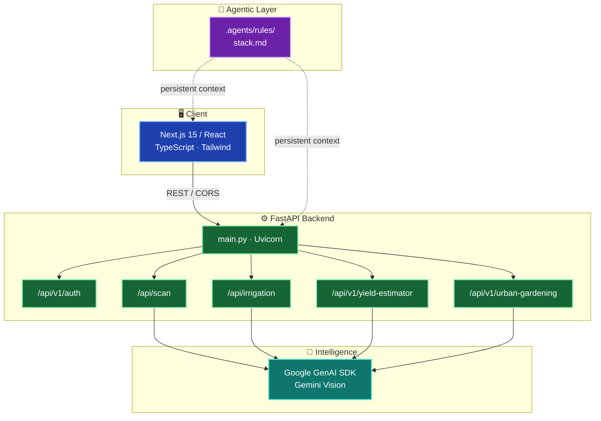

<div align="center">
  

  <br />

  <!-- Tech Stack Badges — official brand colors -->
  <a href="https://nextjs.org/"></a>
  <a href="https://fastapi.tiangolo.com/"></a>
  <a href="https://www.python.org/"></a>
  <a href="https://nodejs.org/"></a>
  <a href="https://ai.google.dev/"></a>
  <a href="./.agents/rules/"></a>

  <br /><br />

  <h3>
    <em>Crop intelligence that scans, predicts, irrigates — and never sleeps.</em>
  </h3>

  <p>
    Modular AI agriculture stack: Next.js frontend · FastAPI brain · Gemini vision · agent-ready workspace rules.
  </p>

  <p>
    <a href="#-quick-start"><strong>Get Started →</strong></a>
    &nbsp;·&nbsp;
    <a href="#-architecture"><strong>Architecture</strong></a>
    &nbsp;·&nbsp;
    <a href="#-agentic-context"><strong>Agentic Context</strong></a>
  </p>
</div>

---

## ⚡ Core Intelligence Stack

<p align="left">
  <em>Click on any module below to inspect system capabilities, AI models, and telemetry flows.</em>
</p>

<details open>
<summary><strong>🔬 Module 01: Crop Disease Scanner</strong> &nbsp;<code>[Gemini Vision]</code> <code>[Multimodal]</code></summary>
<br />

| Field | Capability |
| :--- | :--- |
| **Primary Model** | `Gemini 1.5 Pro / Vision` |
| **Input Pipeline** | Leaf Micro-imagery + Voice/Text Context |
| **Localization** | Multi-Language Inference (English & Tamil) |

- 👁️ **Visual Pathogen Engine:** Scans plant leaf imagery in milliseconds to flag early-stage blights, rusts, and nutrient deficiencies.
- 🎙️ **Farmer Voice Overlay:** Accepts optional regional audio or text commentary to fine-tune diagnostic confidence scores.
- ⚡ **Treatment Blueprint:** Outputs actionable, eco-friendly remediation steps with localized crop management tips.

</details>

<br />

<details open>
<summary><strong>💧 Module 02: Smart Irrigation Advisor</strong> &nbsp;<code>[Telemetry Engine]</code> <code>[Hydration Logic]</code></summary>
<br />

| Field | Capability |
| :--- | :--- |
| **Telemetry Ingestion**| Soil Moisture, Crop Growth Stage, Climate Data |
| **Optimization Target**| Evapotranspiration Minimization |
| **Output Type** | Precision Volumetric & Timed Dosing |

- 📡 **Real-Time Telemetry Matrix:** Dynamically processes soil composition, humidity metrics, and local weather patterns.
- ⏱️ **AI Hydro-Scheduling:** Computes high-efficiency watering windows designed to eliminate surface runoff and evaporation.
- 🌿 **Water Thrift Protocol:** Maximizes Water-Use Efficiency (WUE) without stress-inducing crop yields.

</details>

<br />

<details open>
<summary><strong>📊 Module 03: Yield Prediction Matrix</strong> &nbsp;<code>[Agro-Analytics]</code> <code>[Predictive ML]</code></summary>
<br />

| Field | Capability |
| :--- | :--- |
| **Forecast Metric** | Tonnage / Acreage Projections |
| **Analytics Engine** | Multi-Factor Growth Driver Mapping |
| **Use Case** | Pre-Season ROI & Resource Allocation |

- 🧮 **Harvest Simulator:** Calculates estimated crop output based on acreage, seed variant, and applied fertigation schedules.
- 📈 **Growth Driver Profiler:** Highlights critical yield bottlenecks and delivers stage-by-stage nutrient directives.
- 🎯 **Seasonal Simulation:** Enables farmers to stress-test resource allocation models prior to field planting.

</details>

<br />

<details open>
<summary><strong>🏙️ Module 04: Urban Gardening Hub</strong> &nbsp;<code>[Micro-Farming]</code> <code>[Space-Aware]</code></summary>
<br />

| Field | Capability |
| :--- | :--- |
| **Environment Focus**| Balconies, Vertical Racks & Small Plots |
| **Copilot Mode** | Adaptive Micro-Climate Recommendations |
| **Security Layer** | JWT / Session-Based User Profiling |

- 🪴 **Micro-Footprint Tactical Guides:** Tailored agricultural playbooks designed specifically for high-density, urban spaces.
- 🧠 **AI Plant Copilot:** Tailored care strategies optimized for specific pot volumes, direct sunlight hours, and container flora.
- 🔐 **Zero-Trust Access:** Secure session management and state persistence for urban growers and community garden managers.

</details>

---

## 🏗 Architecture

Live system map — frontend, backend APIs, Gemini, and agent rules:



### 📂 Workspace Tree

```text
agrosphere/
├── 🎨 frontend/              # Next.js · React · Tailwind · TypeScript
│   └── app/                  # App Router pages & lib (scan, irrigation, yield, urban)
├── 🐍 backend/               # FastAPI · Uvicorn · Pydantic · SQLAlchemy
│   ├── routers/              # Auth · Irrigation · Yield · Urban Gardening
│   ├── services/             # Gemini + domain business logic
│   ├── schemas/              # Request / response contracts
│   └── models/               # ORM models
├── 🤖 .agents/               # Antigravity agent configuration
│   └── rules/
│       └── stack.md          # Architecture map & @-mention guidelines
├── 🔐 .env.example           # Gemini API key template
└── 📖 README.md              # You are here
```

---

## 🚀 Quick Start

<details>
<summary><strong>✅ Prerequisites</strong> — click to expand</summary>

<br />

| Tool | Version | Why |
|------|---------|-----|
| **Node.js** | v24+ | Next.js frontend runtime |
| **Python** | 3.12+ | FastAPI + GenAI SDK |
| **Gemini API Key** | — | Vision & telemetry intelligence |

</details>

<details>
<summary><strong>🐍 Backend</strong> — FastAPI on port <code>8000</code></summary>

<br />

```bash
# Jump into the API workspace
cd backend

# Spin up an isolated Python environment
python -m venv venv

# Activate it (pick your OS)
# Windows:
.\venv\Scripts\activate
# macOS / Linux:
source venv/bin/activate

# Install the FastAPI + GenAI stack
pip install -r requirements.txt

# Drop in your secrets (edit GEMINI_API_KEY after copy)
cp ../.env.example .env

# Launch hot-reload API — http://localhost:8000
uvicorn main:app --reload --port 8000
```

> Health check: `GET http://localhost:8000/api/health`

</details>

<details>
<summary><strong>🎨 Frontend</strong> — Next.js on port <code>3000</code></summary>

<br />

```bash
# Enter the UI workspace
cd frontend

# Install dependencies (Node v24+)
npm install

# Fire up the App Router — http://localhost:3000
npm run dev
```

> CORS is pre-wired for `http://localhost:3000` → FastAPI.

</details>

<details>
<summary><strong>🔑 Environment</strong> — Gemini key</summary>

<br />

```bash
# Root template (.env.example)
GEMINI_API_KEY="YOUR_GEMINI_API_KEY_HERE"

# Copy into backend before first run
cp .env.example backend/.env
# Then replace the placeholder with your real key from Google AI Studio
```

</details>

---

## 🤖 Agentic Context

Autonomous coding tools (**Cursor**, **Copilot**, **Antigravity**, and friends) should treat this repo as agent-first:

1. **Read** [`.agents/rules/stack.md`](./.agents/rules/stack.md) before touching architecture — it is the persistent source of truth for runtimes, frameworks, and `@backend` / `@frontend` / `@env` mappings.
2. **Respect** the stack contract: Python 3.12 + FastAPI + `google-genai` on the server; Node.js v24 + Next.js + TypeScript + Tailwind on the client.
3. **Prefer** existing routers/services/schemas over inventing parallel layers — the folder map above is the law.

Ship faster. Hallucinate less. Keep the harvest green. 🌾

---

<div align="center">
  
  <p><strong>Agrosphere</strong> — open source · AI-native · built for the field</p>
  <p><sub>Contributions welcome. Star the repo if this helps your next season.</sub></p>
</div>
