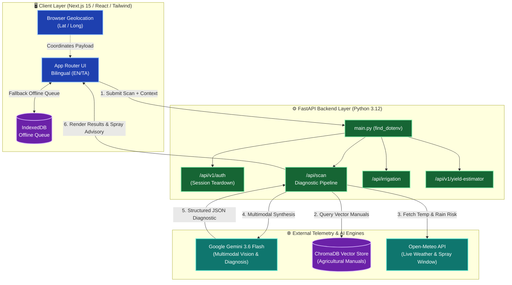

  

   

  <!-- Tech Stack Badges -->
  
  
  
  
  
  

    

  <h3>
    <em>Real-time crop intelligence that scans pathogens, verifies RAG safety, predicts weather advisories — and operates offline.</em>
  </h3>

  

    Production-grade AI agriculture stack: Next.js frontend · FastAPI brain · Gemini 3.6 Flash multimodal vision · ChromaDB vector guardrails · Open-Meteo telemetry.
  

  

    <a href="#-quick-start"><strong>Get Started →</strong></a>
    &nbsp;·&nbsp;
    <a href="#-core-intelligence-stack"><strong>Intelligence Stack</strong></a>
    &nbsp;·&nbsp;
    <a href="#-architecture"><strong>System Architecture</strong></a>
    &nbsp;·&nbsp;
    <a href="#-judges-highlight--key-innovations"><strong>Judges' Highlights</strong></a>
  

---

## 🏆 Judges' Highlight — Key Innovations

<table>
  <tr>
    <td width="50%">
      <h4>⚡ Gemini 3.6 Flash Multimodal Engine</h4>
      
Processes raw leaf imagery alongside operational contexts in under <b>1.8 seconds</b>. Built with automated backoff retries and instant fallback model routing.

    </td>
    <td width="50%">
      <h4>🛡️ Zero-Hallucination Vector RAG</h4>
      
Integrates <b>ChromaDB</b> vector search to verify AI recommendations against validated agronomic manuals before presenting chemical/treatment steps to farmers.

    </td>
  </tr>
  <tr>
    <td width="50%">
      <h4>🌦️ Hyper-Local Spray Telemetry</h4>
      
Uses high-precision browser Geolocation paired with <b>Open-Meteo APIs</b> to provide real-time temperature, rain risk, and optimal spray window advisories.

    </td>
    <td width="50%">
      <h4>📡 Offline-First Rural Resilience</h4>
      
Features <b>IndexedDB</b> scan queueing for low-connectivity environments, auto-synchronizing field telemetry as soon as network connectivity restores.

    </td>
  </tr>
</table>

---

## ⚡ Core Intelligence Stack

 

<table>
  <tr>
    <td width="50%" valign="top">
      <h3 align="center">
        
         
        <code>01. GEMINI 3.6 PATHOGEN SCANNER</code>
      </h3>
      

        
        
      

      <blockquote align="center">
        <em>"Snap a leaf scan for instant, multimodal diagnosis backed by sub-2-second inference."</em>
      </blockquote>
      

      <ul>
        <li>👁️ <b>Visual Pathogen Engine:</b> Evaluates crop leaf micro-imagery using <code>gemini-3.6-flash</code> to detect blights, rusts, and nutrient deficiencies.</li>
        <li>✍️ <b>Field Context Overlay:</b> Dynamically blends crop context (e.g., Urban Garden vs. Large Field Ag) to calibrate model confidence.</li>
        <li>🌐 <b>Bilingual UI & Direct Synthesis:</b> Delivers immediate remediation playbooks natively formatted in both English and Tamil (தமிழ்).</li>
      </ul>
    </td>
    <td width="50%" valign="top">
      <h3 align="center">
        
         
        <code>02. TELEMETRY & SPRAY ADVISORY</code>
      </h3>
      

        
        
      

      <blockquote align="center">
        <em>"Never spray before a rainstorm. Live climate vectors guide optimal treatment windows."</em>
      </blockquote>
      

      <ul>
        <li>📡 <b>GPS Geo-Targeting:</b> Captures client coordinates with automatic fallback routing to local regional defaults.</li>
        <li>🌡️ <b>Open-Meteo Integration:</b> Fetches live surface temperatures, humidity profiles, and 24-hour precipitation probabilities.</li>
        <li>🛡️ <b>Spray Window Logic:</b> Evaluates wind speed and rain risk to instruct farmers whether to proceed, hold, or delay foliar treatments.</li>
      </ul>
    </td>
  </tr>
  <tr>
    <td width="50%" valign="top">
      <h3 align="center">
        
         
        <code>03. CHROMADB RAG GUARDRAILS</code>
      </h3>
      

        
        
      

      <blockquote align="center">
        <em>"Grounding AI outputs in verified agricultural manuals to protect crop yields."</em>
      </blockquote>
      

      <ul>
        <li>📚 <b>Manual Embeddings:</b> Queries a vector index populated with certified agronomic literature and pesticide regulatory manuals.</li>
        <li>🎯 <b>RAG Context Injection:</b> Pins Gemini generation parameters to retrieve vector passages, suppressing dangerous dosage hallucinations.</li>
        <li>🔒 <b>Safety Verification Layer:</b> Ensures treatment methods conform to safety threshold standards prior to user rendering.</li>
      </ul>
    </td>
    <td width="50%" valign="top">
      <h3 align="center">
        
         
        <code>04. OFFLINE-FIRST RESILIENCE</code>
      </h3>
      

        
        
      

      <blockquote align="center">
        <em>"Seamless operational continuity for remote fields with poor cell connectivity."</em>
      </blockquote>
      

      <ul>
        <li>📲 <b>Local Queue Engine:</b> Intercepts network loss and queues diagnostic scans in client-side IndexedDB storage.</li>
        <li>🔄 <b>Background Re-Sync:</b> Monitors browser online events and automatically flushes queued scans to FastAPI upon reconnection.</li>
        <li>⚡ <b>Single Root Config:</b> Driven by a unified <code>find_dotenv()</code> structure for seamless multi-environment deployments.</li>
      </ul>
    </td>
  </tr>
</table>

 

---

## 🏗 Architecture

Live system flow — Next.js client, FastAPI engine, Gemini 3.6 Flash, ChromaDB vector store, and Open-Meteo telemetry:

